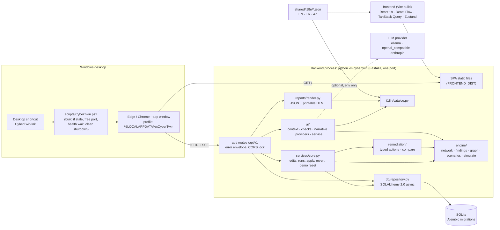

# Architecture

CyberTwin is one Python process (FastAPI + the engine) that also serves the built React app, opened
as a Chromium `--app` window by a PowerShell launcher. Everything is computed from the stored virtual
model; nothing touches real infrastructure.

## Backend (`backend/src/cybertwin`)
| Module | Role |
|---|---|
| `domain/model.py` | Pydantic v2 model of one revision (`TwinContent`): assets, connections, principals, firewall rules, vulnerabilities, policy. Immutable, validated (referential integrity), canonical JSON + SHA-256 content hash. |
| `domain/diff.py` | Structural diff between two revisions. |
| `db/` | SQLAlchemy 2.0 async tables, Alembic migration `0001_initial`, repository (the only DB access; portable SQL). Revisions are append-only; node positions are stored separately so dragging never creates revisions. |
| `engine/` | Deterministic attack-graph simulation (NetworkX): reachability through ordered firewall rules, edge generators, scenarios, scoring, Top-K paths, chokepoints, greedy recommendations, residual exposure, replay timeline, `result_hash`. See [ENGINE.md](ENGINE.md). |
| `remediation/` | Typed actions (`restrict_port`, `enforce_mfa`, `set_password_policy`, `apply_patch`, `reduce_permission`, `segment_zones`) as pure functions on a snapshot; before/after comparison (blocked / reduced / new paths, per-asset deltas). |
| `services/` | Use cases: demo reset, CRUD edits as new revisions (with cascade + dependents), run, apply, revert, restore. |
| `ai/` | Grounding (placeholder values, known ids), post-checks, engine-rendered narrative and deterministic EN/TR/AZ template explanation, provider adapters, explanation cache, grounded chat. |
| `api/` | FastAPI app factory, routers, one error envelope, SPA serving, SSE endpoints. See [API.md](API.md). |
| `i18n/catalog.py` | Reads the shared catalogs; i18next-compatible interpolation and plurals; number/percent/date formatting per language. |

## Frontend (`frontend/src`)
| Area | Role |
|---|---|
| `api/` | `fetch` wrapper (error envelope → `ApiError` with i18n code), POST-SSE reader, TanStack Query hooks, CRUD mutations. |
| `store/` | Zustand: language, twin, viewed revision, scenario, foothold; guided-demo state; toasts. |
| `i18n/` | i18next with the shared catalogs bundled at build time; formatters; engine message renderer (same variant rules as the backend). |
| `components/map/` | React Flow topology: neon pedestal nodes, particle edges, attack-path highlighting, logical hops, readability-aware camera (min zoom keeps labels ≥ 11 px; compact mode for mini maps). |
| `components/` | Shell (top bar, icon rail, menus), glass panels, dialogs, toasts, forms with validation, asset drawer, guided tour. |
| `pages/` | Overview, Network map, Assets, Attack simulation (replay), Vulnerabilities, AI assistant, Remediation, Reports. |
| `lib/` | Replay frames, model helpers, notes/events text, error text, tour steps. |

## Data flow of the demo
1. **Run**: `POST /twins/{id}/simulations` → `services.core.run_simulation` → `engine.simulate`
   (pure, deterministic) → stored in `simulation_runs` with `result_hash` → UI replays
   `timeline.primary` frame by frame.
2. **Fix**: `POST /twins/{id}/remediations/apply` → actions applied to a copy of the head snapshot →
   new revision (`kind=remediation`) → scenario re-run on before and after → comparison stored.
3. **Revert**: `POST /remediations/{rid}/revert` → new revision with the pre-fix content → re-run →
   the `result_hash` equals the original run's hash (same content, same result).

## Determinism
Sorted ids everywhere, insertion-ordered graphs, no randomness, floats rounded to 6 decimals,
canonical JSON for hashing. Tests assert byte-identical results, also with shuffled input order.

## Testing
- Backend: pytest on a real temporary SQLite with real migrations (engine, remediation, API, AI,
  i18n), ruff, mypy --strict.
- Frontend: tsc, eslint, vitest (catalog key/placeholder parity).
- E2E: Playwright against the real backend + `vite build && vite preview`, Microsoft Edge.
- Desktop: the real launcher, opened from the Desktop shortcut, driven over CDP
  (`frontend/scripts/verify-desktop.mjs`).
