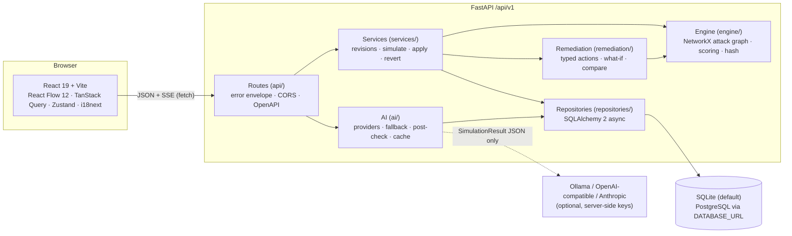

# Architecture

## Backend (`backend/app`)

| Package | Responsibility |
|---|---|
| `schemas/` | Pydantic v2 models: `TwinSnapshot` (assets, connections, principals, firewall rules, vulnerabilities, segmented zones) with referential-integrity validation; `SimulationResult`; remediation action union; API bodies. |
| `models/` | SQLAlchemy 2.0 tables: `twins`, `twin_revisions` (immutable snapshot JSON + parent + note + diff), `layout_positions`, `simulation_runs` (result JSON + hash), `remediation_records`, `ai_cache`, `events`. Portable column types only. |
| `db/` | Async engine/session; runs Alembic `upgrade head` on startup (single schema source of truth). |
| `repositories/` | The only code that issues SQL (ORM queries; no dialect-specific SQL). |
| `engine/` | Deterministic attack-graph simulation (see ENGINE.md). Pure functions. |
| `remediation/` | `actions.py` applies typed actions to a snapshot copy; `candidates.py` derives fixes from findings; `recommend.py` builds what-if recommendations and before/after comparisons. |
| `ai/` | Provider adapters returning schema-constrained JSON, placeholder filling (`structured.py`), integrity post-checks (numbers ±0.5 %, citations, order, duplicates, unknown placeholders, unverified ids), deterministic EN/TR template fallback, cache keyed by `result_hash`. |
| `i18n/` | Engine message catalog (EN + TR), server-side `render()` / `localize()` for reports, the LLM payload and the template fallback. |
| `services/` | Orchestration: revision mutation with validation + diff, simulation runs + events, apply/revert, demo reset. |
| `api/` | FastAPI routers. |
| `seed/` | Northwind Logistics demo twin. |

### Revisions

Every edit (asset/connection/principal/rule/vuln CRUD), remediation and revert creates a new numbered
revision; nothing is updated in place. Revert of revision R creates R+n whose snapshot equals R's parent.
Node positions are stored separately (`layout_positions`) so dragging does not create revisions; positions
never enter the engine or the result hash. Mutations accept `?expected_revision=` for optimistic concurrency.

### Translatable output

The engine emits `{code, params}` messages; the frontend loads the catalog from `GET /api/v1/i18n/engine` into an
i18next `engine` namespace and renders them (`useMsg()`), so step reasons, change logs and notifications follow the
UI language. The server uses the same catalog for printable reports and the template fallback.

### AI boundary

The model receives only `explain_payload(SimulationResult[, Comparison])` (rendered in English) plus a fixed system
prompt and a list of placeholder keys. It must answer with schema-constrained JSON in which every quantity is a
placeholder; the server fills the values from the engine result and renders the step-by-step attack narrative from
the engine itself. Post-checks report stray numbers, wrong-path citations, unknown placeholders, order violations,
duplicates and unverified ids; the UI shows them as "Integrity checks". Provider errors, timeouts and invalid JSON
retry with exponential backoff, then fall back to the template. Evidence: docs/AI_EVAL.md.

## Frontend (`frontend/src`)

| Folder | Content |
|---|---|
| `design/` | Tailwind v4 `@theme` tokens (colors, fonts), glass panel component classes, motion + reduced-motion rules, React Flow theme. |
| `api/` | Typed client mirroring backend schemas, error envelope → `ApiError`, timeouts, POST-SSE reader; TanStack Query hooks. |
| `stores/` | Zustand: UI state (twin, viewed revision, selection, zone/type filters, last simulation) and the pure replay reducer. |
| `features/map/` | `buildFlow` (pure) → React Flow nodes/edges; neon pedestal nodes; particle edges (SVG `animateMotion`); zone and blast-radius layers. |
| `features/*` | Assistant streaming store (`useSyncExternalStore`), markdown renderer with unverified flags, replay helpers, remediation labels. |
| `pages/` | The 8 pages. |
| `i18n/` | EN + TR resources; `tr` is typed as `typeof en`, and i18next keys are type-checked. |

## Testing layers

* `backend/tests/engine`, `remediation`: pure engine/remediation unit + scenario tests.
* `backend/tests/api`: FastAPI app with a real temp SQLite DB, real migrations, real seed (TestClient).
  `test_ai.py::test_live_ollama_explain_and_cache` hits a real local Ollama when reachable.
* `frontend/src/__tests__`: scoring display, replay reducer, SSE parsing, map builder.
* `e2e/`: Playwright against real uvicorn + real Vite (fresh SQLite DB per run).
